# Episode 1 — Start Here: Open, Build and Play
Follow this with your own separate lesson save. **The numbers in the demonstration are examples, not a required answer. Choose positions, directions and sizes that suit your scene.** The lesson first identifies the entrance and workspace, then explains the camera, two scenery objects and private testing. All game pictures are real game captures; the teaching diagrams organise those pictures and their values.

Camera practice first uses the completed pair as a reference. After learning the view controls, return to the blank editing scene and build your own copy. The two labelled editor-reference views pause real controls so you can read them before the live input.

## 1. Find the creator entrance

Start in the normal PC open world with an account where Miliastra Wonderland is already unlocked. Press **Esc**, scroll down to the **Miliastra Wonderland** section in the Paimon Menu, then choose **My Miliastra**. The adjacent **Wonderland** button browses and plays stages. If the section is missing, check the unlock requirements in your current game; this lesson does not establish a new-account unlock procedure.

Official concept: [1.1 Basic Understanding of Editor Interface](https://act.hoyoverse.com/ys/ugc/tutorial/course/detail/mhlcjxr9duvy?lang=en-us).

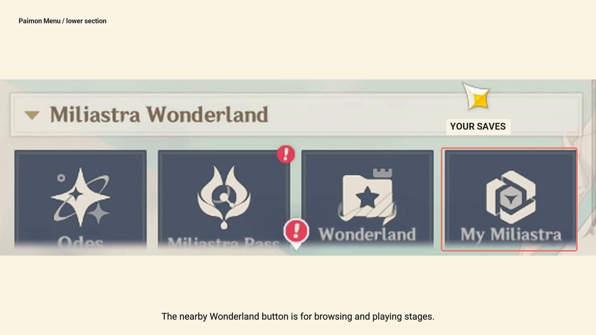

## 2. Understand Local Save

Stay on **Local Save**. Each project contains its stage settings and placed content. **Edit** reopens an existing save. For the exercise, create a separate lesson save and leave your other projects intact.

Official concept: [1.2 Map Creation and Playtesting](https://act.hoyoverse.com/ys/ugc/tutorial/course/detail/mhcegrr5omvi?lang=en-us).

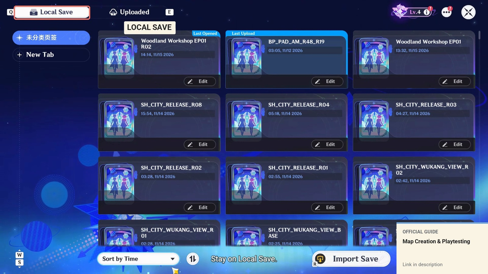

## 3. Create a separate lesson project

Choose **Create New Save** at the bottom right. Use a recognisable name, such as **Woodland Workshop Episode One**. The button detail comes from a clean native game-client screenshot; the small privacy tile in the wide recording is not part of the game UI.

Official concept: [1.2 Map Creation and Playtesting](https://act.hoyoverse.com/ys/ugc/tutorial/course/detail/mhcegrr5omvi?lang=en-us).

## 4. Choose Beyond Mode

Select **Beyond Mode**, keep the other options as shown and choose **Confirm**. Beyond Mode uses **Manekins**. Classic Mode uses Teyvat characters. This series uses Beyond Mode consistently. Wait for the blank editing field.

Official concept: [Before You Read](https://act.hoyoverse.com/ys/ugc/tutorial/detail/mh29wpicgvh0?lang=en-us).

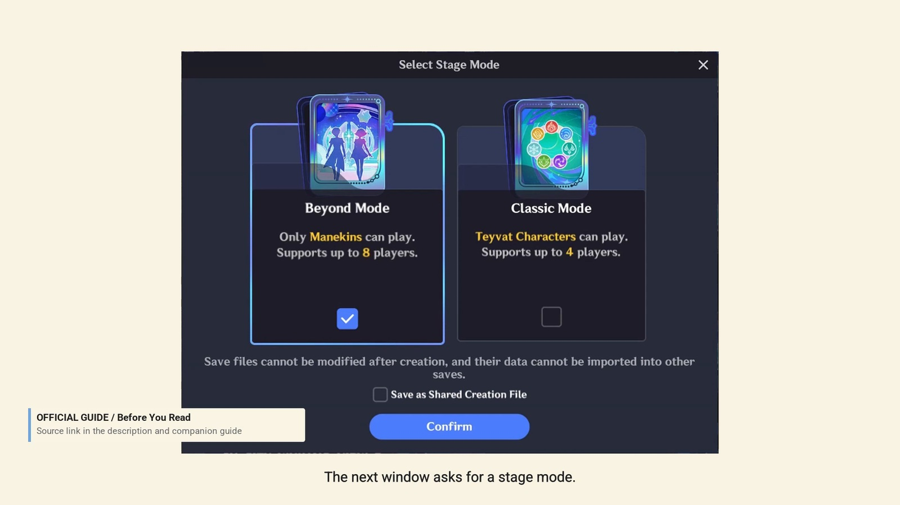

## 5. Know the workspace

The middle is the scene. **Place** on the left is the object library. Selecting an object opens **Details** on the right. The upper-left menu button opens the editor **System Menu** for stage settings, saving and testing. Inside the editor, **Esc** opens this editor menu.

Official concept: [1.1 Basic Understanding of Editor Interface](https://act.hoyoverse.com/ys/ugc/tutorial/course/detail/mhlcjxr9duvy?lang=en-us).

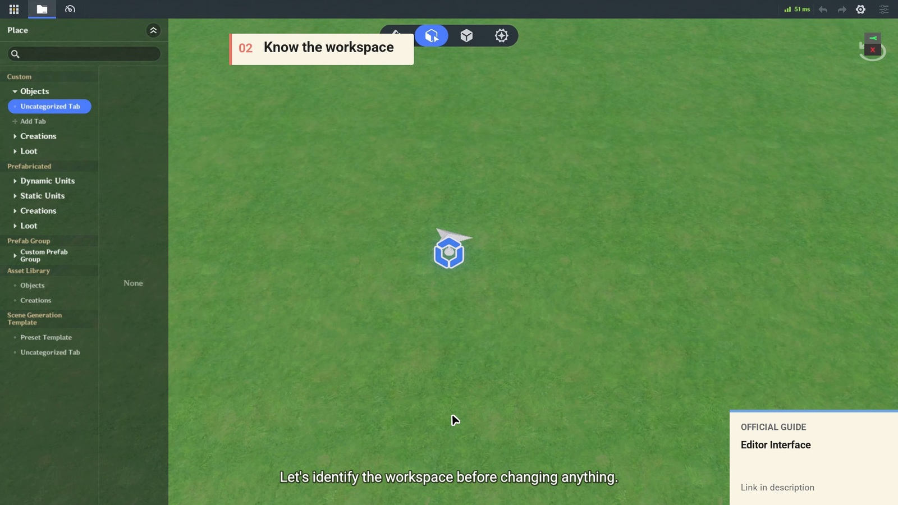

## 6. Move the editing camera

Click empty ground to leave numeric text fields. Hold **right mouse** and move the mouse to look. Keep right mouse held and briefly press **W** to move forward; release W to stop. Scroll backward to pull the view away. This changes the editor view, while the placed objects keep their world positions. It does not configure the player starting point.

Official concept: [Main Interface](https://act.hoyoverse.com/ys/ugc/tutorial/detail/mhn4bsi5lb58?lang=en-us).

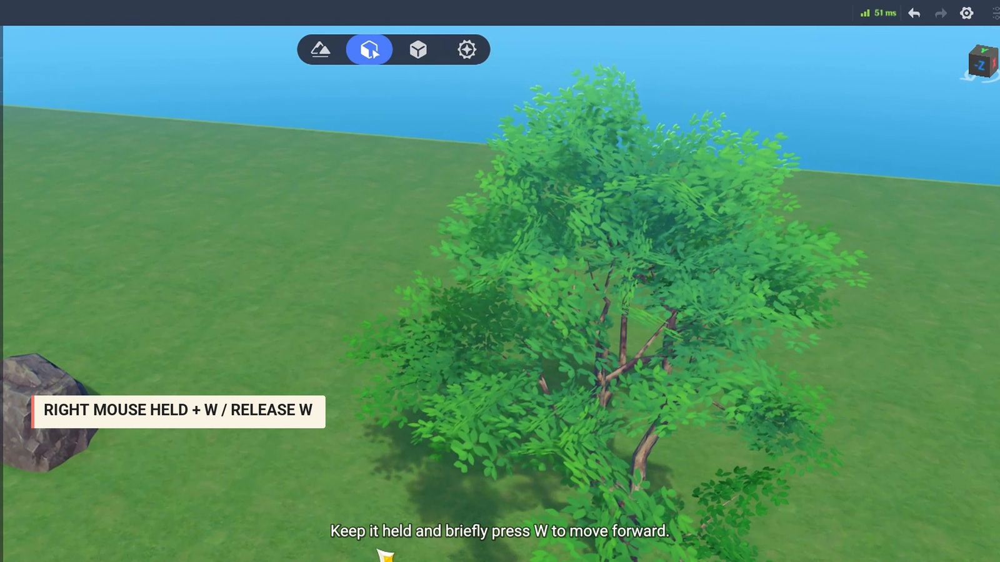

## 7. Use slower camera movement

Open the upper-right **Quick Settings** gear. **Camera Horizontal Speed (m/s)** is lowered from **25 to 10** in the example. **Camera Vertical Speed (m/s)** stays at **25**. Close the panel and try a short movement. This is an editor camera setting, not player walking speed. Choose a value that suits your mouse and scene.

Official concept: [Main Interface](https://act.hoyoverse.com/ys/ugc/tutorial/detail/mhn4bsi5lb58?lang=en-us).

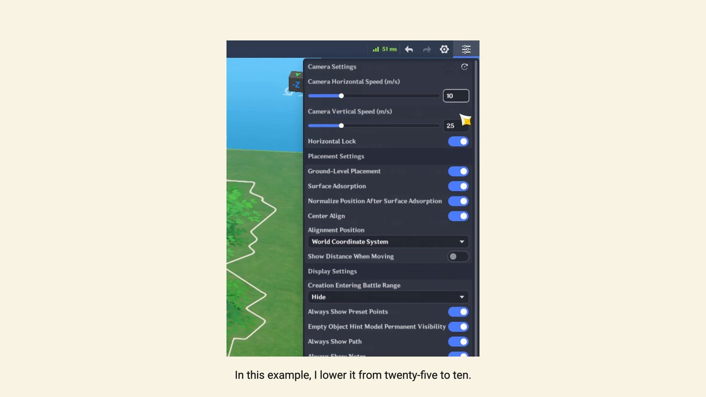

## 8. Understand Entity Placement

An entity is one placed item. **Entity Placement** creates scene entities and edits their data. Static scenery objects suit this tree-and-rock exercise. Dynamic objects support gameplay features such as components and node graphs. Those later systems are outside this first lesson.

Official concept: [Entity Placement](https://act.hoyoverse.com/ys/ugc/tutorial/detail/mhnffmieeqbg?lang=en-us).

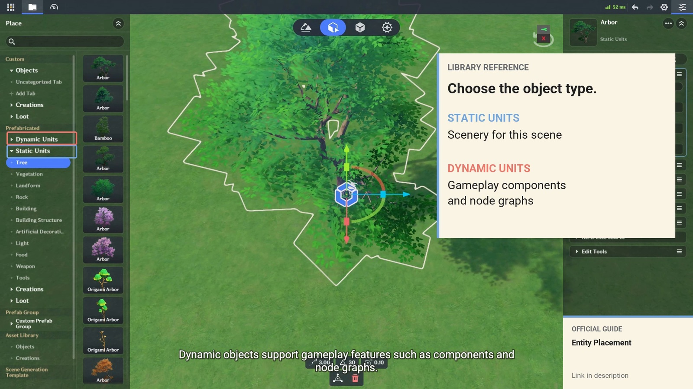

## 9. Place and select an Arbor

In **Place → Prefabricated → Static Units → Tree**, click an **Arbor** card. A card is a library source; the outline and **Arbor** name identify the placed instance. The initial position can depend on your editing view. Set the intentional coordinates next.

Official concept: [Entity Placement](https://act.hoyoverse.com/ys/ugc/tutorial/detail/mhnffmieeqbg?lang=en-us).

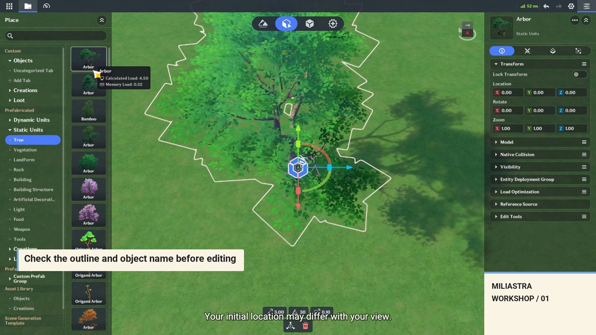

## 10. Read Transform before typing

**Location** sets position in world coordinates, **Rotate** sets orientation and **Zoom** sets object scale. On this flat field X and Z run across the ground and Y sets height. Camera turning changes screen directions while these world-coordinate values stay the same.

Official concept: [Transform, Native Collision, Visibility and Create Settings](https://act.hoyoverse.com/ys/ugc/tutorial/detail/mhuqbn9yn5bu?lang=en-us).

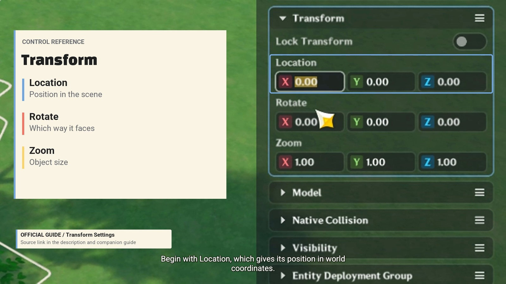

## 11. Set the tree position

Select Arbor and open **Transform → Location**. Click an existing number, select its old value, type a new value and press **Enter**. The recording uses **8 / 0 / 16** to demonstrate entering X, Y and Z; your tree can be elsewhere. Keep it at a suitable ground height, apply each changed field and check the visible result. If the tree leaves the current view, use the camera to find it. Read back the fields to confirm your intended change.

Official concept: [Transform, Native Collision, Visibility and Create Settings](https://act.hoyoverse.com/ys/ugc/tutorial/detail/mhuqbn9yn5bu?lang=en-us).

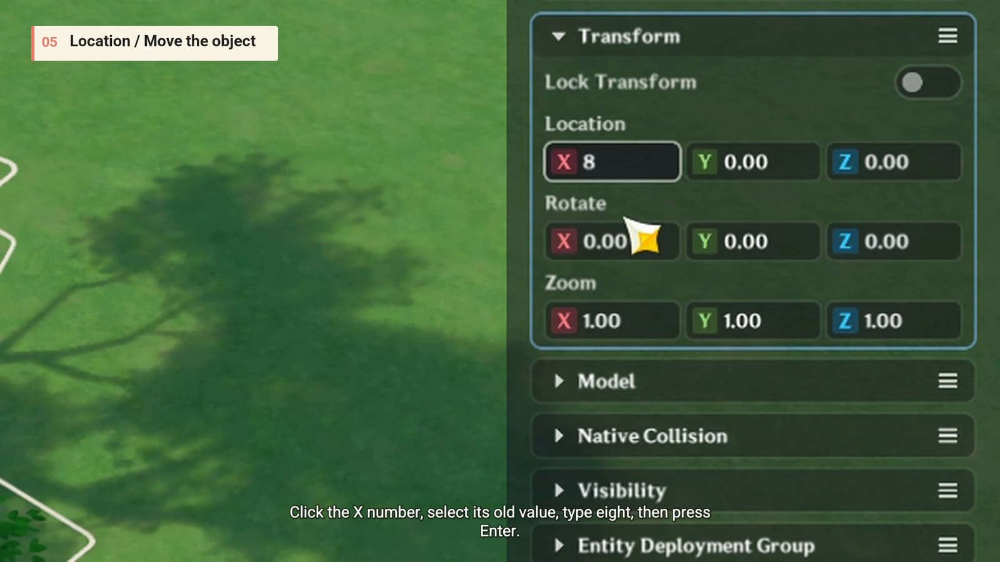

## 12. Place an uneven Rock

Open **Static Units → Rock** and click an uneven rock with a recognisable long side. Confirm the outline and the name **Rock**. Values apply to the current selection. If clicking empty ground removes Details, select the intended object again.

Official concept: [Entity Placement](https://act.hoyoverse.com/ys/ugc/tutorial/detail/mhnffmieeqbg?lang=en-us).

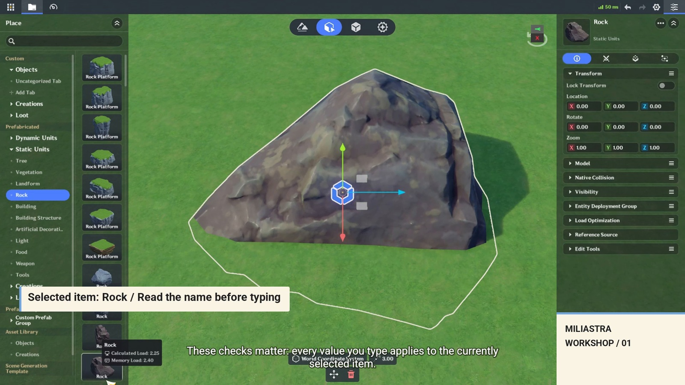

## 13. Rotate the Rock

Under **Rotate**, enter **Y 90** and press Enter. Ninety degrees is a quarter-turn. Watch the long side change direction while Location remains unchanged. Use the field value and the visible shape together.

Official concept: [Transform, Native Collision, Visibility and Create Settings](https://act.hoyoverse.com/ys/ugc/tutorial/detail/mhuqbn9yn5bu?lang=en-us).

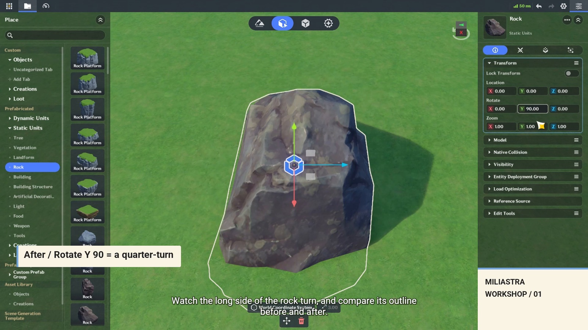

## 14. Resize the Rock evenly

In the **Zoom** group, **1** is original size and **0.5** is half size in that dimension. Enter and apply **0.5 in X, Y and Z**. One-axis scaling changes proportions. Three equal values preserve the original proportions at a smaller size. The picture compares actual one-axis and three-axis recordings.

Official concept: [Transform, Native Collision, Visibility and Create Settings](https://act.hoyoverse.com/ys/ugc/tutorial/detail/mhuqbn9yn5bu?lang=en-us).

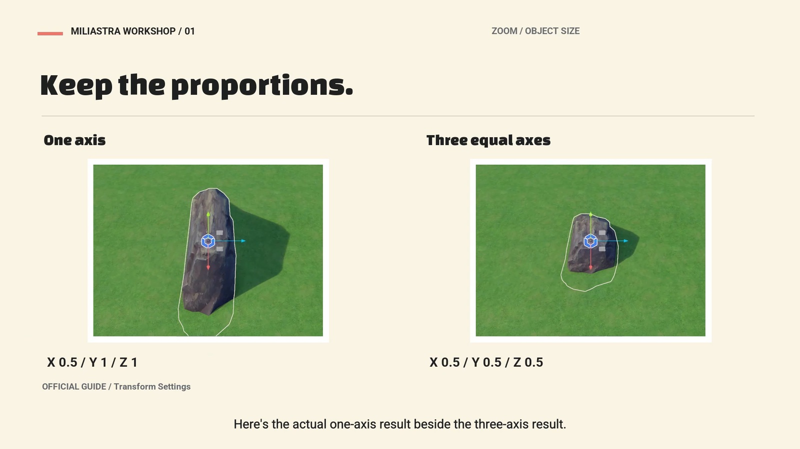

## 15. Practise rotation and uniform scaling

Select **Arbor** again and practise rotation and uniform scaling. Choose a direction and size that suit your layout. The recorded Y rotation of 90 and Zoom of 1.2 are examples: a factor of 1.2 makes each dimension twenty percent larger. Apply each field and observe the result. Keep X, Y and Z equal when you want to preserve proportions.

Official concept: [Transform, Native Collision, Visibility and Create Settings](https://act.hoyoverse.com/ys/ugc/tutorial/detail/mhuqbn9yn5bu?lang=en-us).

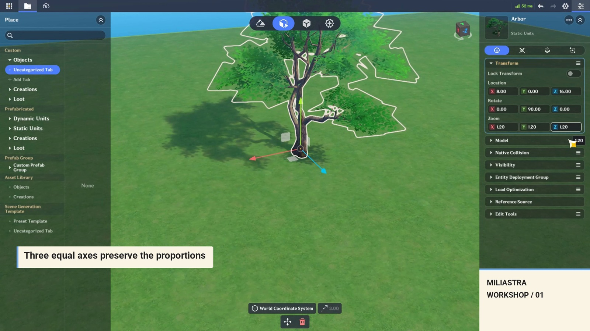

## 16. Leave a walkable opening

Move the Rock to leave a clear opening. The recording uses **−6 / 0 / 16** as one example; your coordinates can differ. Bring both landmarks into view and check whether the spacing supports your own route.

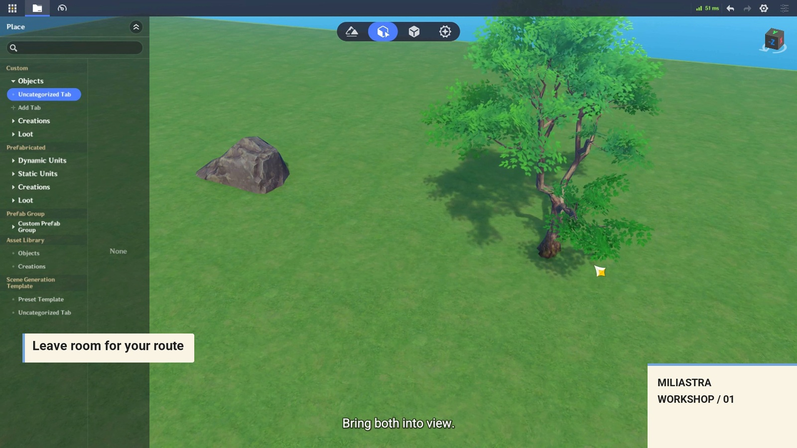

## 17. Recover a recent mistake

The demonstration changes Arbor Zoom X from **1.2 to 0.7**, then clicks the upper toolbar **Undo** arrow. The field returns to **1.20**. Read back the values and the selected name. Undo reverses recent operations; use small, deliberate changes that you can check.

Official concept: [Undo and Restore](https://act.hoyoverse.com/ys/ugc/tutorial/detail/mhq6wdimcd84?lang=en-us).

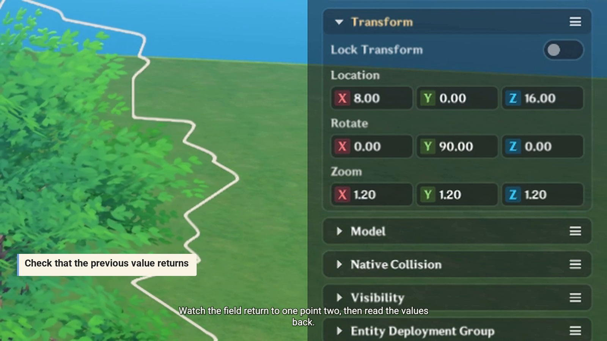

## 18. Quick Save

Open the upper-left **System Menu** and click the disk icon **Quick Save**. Wait for **Saved successfully**. Saving stores stage data in the project; testing lets you inspect the scene from inside the game. Remember the lesson name for reopening it in Local Save.

Official concept: [1.2 Map Creation and Playtesting](https://act.hoyoverse.com/ys/ugc/tutorial/course/detail/mhcegrr5omvi?lang=en-us).

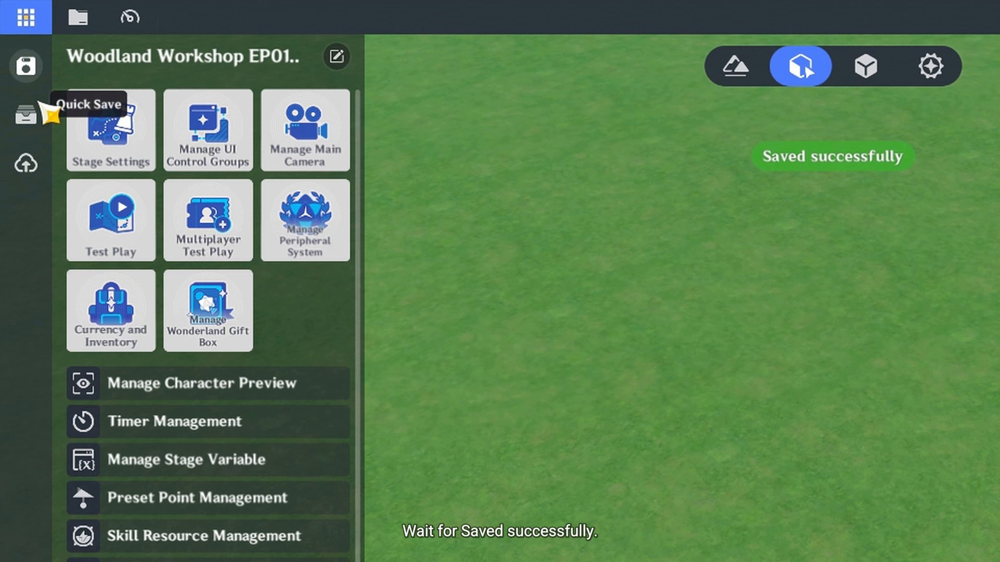

## 19. Prepare a private Test Play

Click **Test Play** in System Menu. The editor validates and prepares test data. In this lesson the navmesh prompt offers **Direct Upload**; select it and wait. In **Test Play Options**, check **Player 1**, **English** and the default Manekin, then **Start Game**. Loading waits are shortened. This editor test is separate from a public release.

Official concept: [Test Play](https://act.hoyoverse.com/ys/ugc/tutorial/detail/mhie54ik9ovg?lang=en-us).

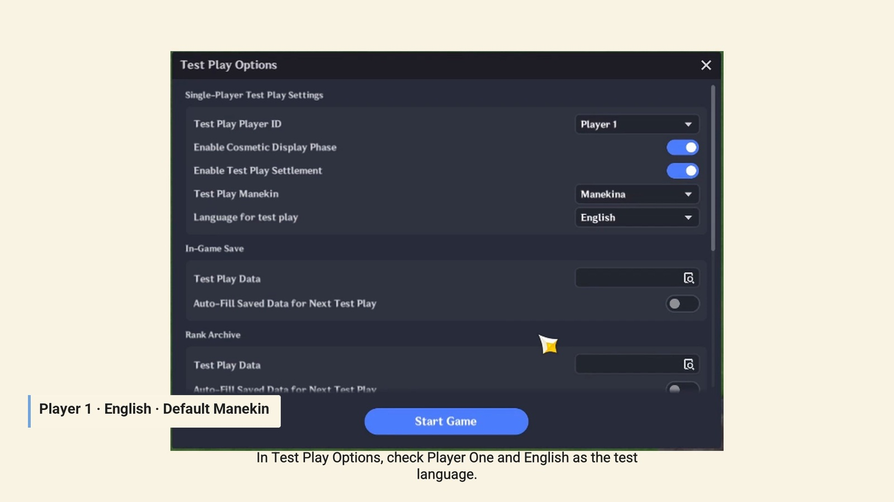

## 20. Walk, stop and turn

Hold **W** to approach, release it to stop, and move the mouse to look. Try walking while turning. Check whether you can approach the tree, pass the opening and recognise the next direction. Ground-level movement gives a better sense of spacing than the high editing view.

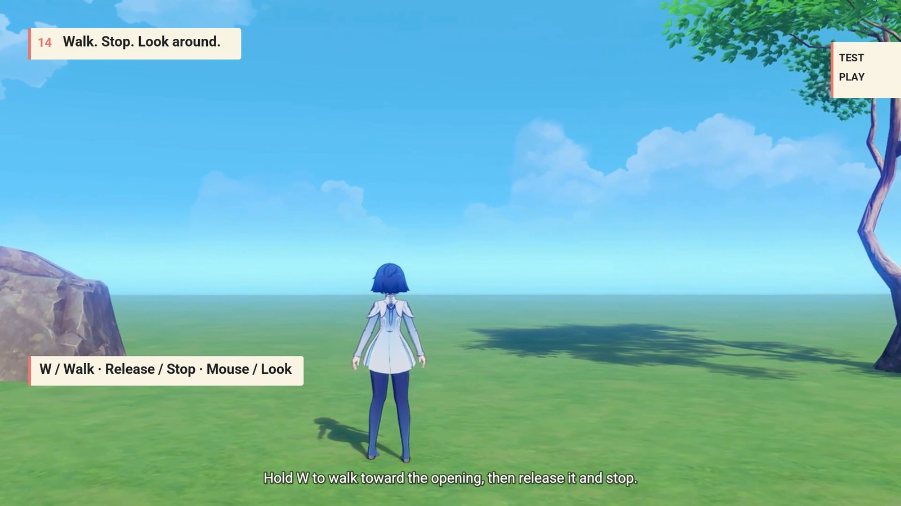

## 21. Return to the editor

Press **Esc**, choose **Abandon Challenge**, then choose **Exit** on the result page. The official guide describes abandoning as a non-standard result. Result wording can differ; this episode ends the scenery test manually and does not demonstrate a natural gameplay settlement. Back in the editor, make one change if needed, Quick Save and test its effect again.

Official concept: [Test Play](https://act.hoyoverse.com/ys/ugc/tutorial/detail/mhie54ik9ovg?lang=en-us).

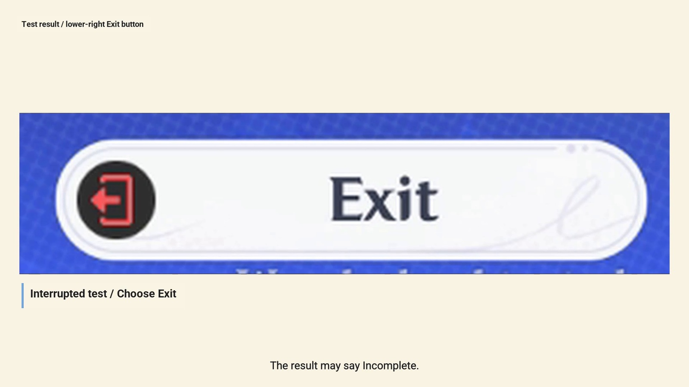

## Check understanding, not identical values

- Can you tell an editor-camera movement from an object movement?
- Can you confirm the selected object and the correct Transform group before typing?
- Can you move, rotate and resize an object deliberately, then explain what changed?
- Can you preserve proportions by using equal X, Y and Z scale values?
- Can you Quick Save, start Test Play and walk through the opening in your own layout?

Your tree and rock do not need to match the recorded coordinates. Placement, direction and size are design choices. The useful outcome is a scene that behaves as intended and has room for the route you want.

Keep the lesson save for Episode 2: a path, a focal point and depth.

[Full official reference index](EP01_Official_References_EN.md).
